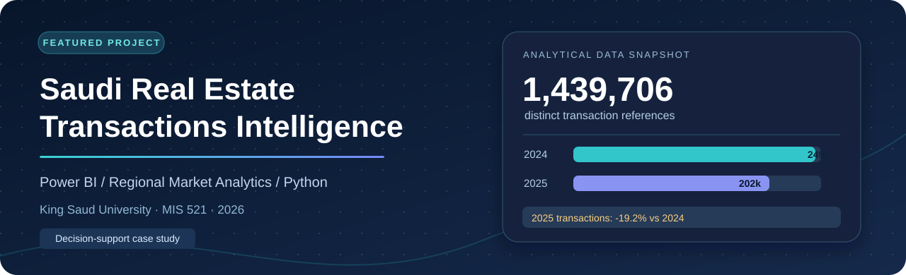
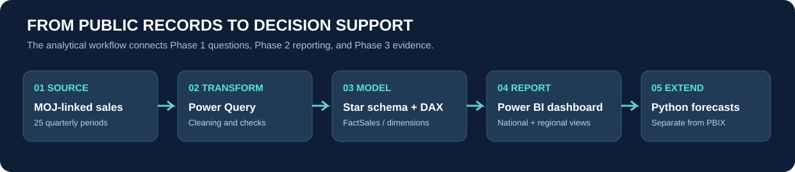
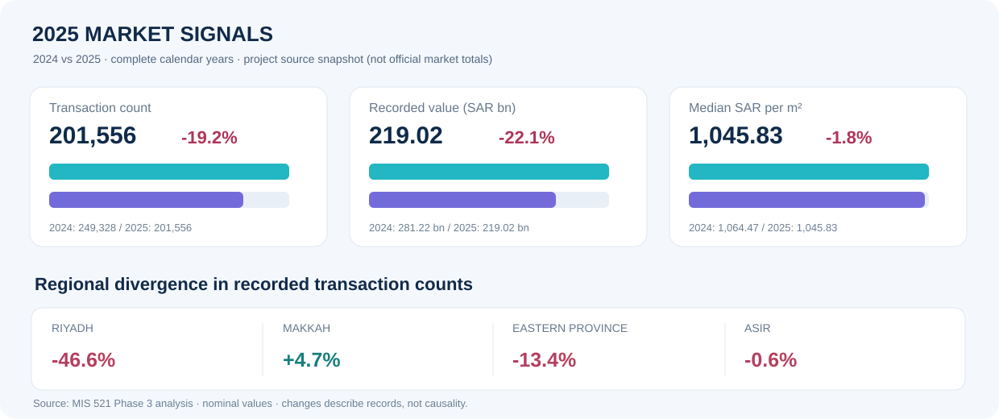

# Saudi Real Estate Transactions Intelligence
### A Power BI Framework for Market Performance and Regional Decision Support

**Business Intelligence · Power Query · DAX · Python · Forecasting · Data Governance**

**Individually implemented by Talal Ibrahim Al-Sultan | MIS 521 · KSU · 2026**

[Executive findings](#executive-findings) · [Data & model](#data-and-analytical-model) · [Forecasting](#forecasting-extension) · [Project documentation](#project-documentation) · [العربية](README_AR.md)

---

> **Project status:** Portfolio case study of an MIS 521 academic project individually developed and implemented by Talal Ibrahim Al-Sultan and formally submitted under Group 2. Figures below are reported results from the supplied consolidated dataset and are **not official Saudi market statistics**. The actual Power BI PBIX, underlying transaction-level dataset and runnable forecast notebook have not been uploaded to this repository. The graphics are portfolio illustrations based on documented aggregates, not screenshots of the live dashboard.

## The business problem

Saudi real-estate transaction records are high-volume and geographically diverse. National totals alone can conceal very different regional movements. The project asks:

**How can transaction data be converted into a transparent, interactive decision-support system for monitoring activity, comparing regions and detecting patterns that warrant investigation?**

Talal developed and implemented the reporting and analysis workflow across three academic phases:

| Phase | Delivered analytical scope | Decision value |
|:--|:--|:--|
| **01 · Define** | Business problem, stakeholders, source review, KPIs and success criteria | Clarify what decision the report should support |
| **02 · Build** | Power Query cleaning, star-schema model, explicit DAX measures, two-page Power BI dashboard and checks | Monitor the national market and explore Region → City → District |
| **03 · Explain** | Regional insights, quantified recommendations, governance, separate Python forecasting evaluation | Translate trends into review priorities without claiming causal proof |

## Project at a glance

| Item | Evidence from final project reports |
|:--|:--|
| Analytical coverage | **1 January 2020 – 31 March 2026**, 25 consecutive quarters |
| Distinct transaction references | **1,439,706** |
| Geography | **13** standardised administrative regions |
| Data model | FactSales, DimDate, DimLocation, DimPropertyClass, plus a disconnected quality-audit table |
| Core KPIs | Distinct transactions, recorded value, mean deal value, median SAR/m², year-on-year count change |
| Power BI submission | **2 pages**, 8 analytical charts/tables, 6 summary cards; year, region and classification filtering |
| Forecasting evaluation | Regional **next-quarter transaction counts**, separate from the submitted PBIX |

The file is a project snapshot derived from public-source material. Some transactions may represent multiple properties, so **transactions are not a count of individual properties**.

## Executive findings

| Indicator | 2024 | 2025 | Change |
|:--|--:|--:|--:|
| Transactions | 249,328 | 201,556 | **−19.2%** |
| Recorded transaction value | SAR 281.22 bn | SAR 219.02 bn | **−22.1%** |
| Median recorded price per m² | SAR 1,064.47 | SAR 1,045.83 | **−1.8%** |
| Average value per transaction | SAR 1,127,893 | SAR 1,086,624 | **−3.7%** |

**Regional contrast.** Riyadh-region recorded counts fell 46.6%, Makkah rose 4.7%, the Eastern Province declined 13.4%, and Asir declined 0.6% between the two complete calendar years. These are **associations in the supplied file**, not evidence of a specific policy or financing effect.

**Decision implication.** A regional drill-down is more informative than applying a single national interpretation to every location. The report identified five Riyadh-region cities for priority review and compared residential indicators for Riyadh city, Jeddah and Dammam. Historical price changes do not establish expected investment returns.

## Data and analytical model

**Source lineage:** the consolidated sales dataset used in the course submission associated with the public [CivilLizard Saudi Real Estate Data repository](https://github.com/civillizard/Saudi-Real-Estate-Data), covering sales records linked to the Saudi Ministry of Justice. We do not claim direct API retrieval or independent certification of the source's completeness.

**Preparation and validation**
- Normalised **16 region spellings into 13 administrative regions**.
- Preserved all distinct transaction references for count and value metrics.
- Excluded **one nonpositive-area record** from median price-per-m² calculations, but not count/value.
- Retained **9,812 source-defined unit-price review flags**; these are screening markers, not proven errors.
- Verified the previously missing **2025 Q2** was restored in the consolidated submission: **42,518 transactions**.
- Used one-to-many, single-direction active relationships from the three dimensions to FactSales.

**Measurement rules.** The median price-per-m² is the median of valid transaction-level value ÷ area, **not** total value ÷ total area. Year-on-year comparisons require matching periods; **2026 Q1 should not be compared with an entire 2025 year**.

See [Data quality & semantic model](docs/data-and-model.md).

## Forecasting extension

A separate **Python / Jupyter** experiment evaluated **RandomForestRegressor** against a **Seasonal Naive** baseline on one-quarter-ahead regional *transaction counts*. The submitted Phase 2 Power BI dashboard was not changed to embed the forecasting model.

| Evaluation metric | Random Forest | Seasonal Naive |
|:--|--:|--:|
| Development validation WAPE | **19.77%** | 27.32% |
| Retrospective 2025 Q1–2026 Q1 holdout WAPE | **24.95%** | 45.44% |
| Retrospective holdout MAE | **898.70** transactions | 1,636.71 transactions |

The forest reported a pooled holdout **R² = 0.790** and **RMSE = 1,989.99** transactions. Yet **10 of 13 regions had negative region-specific R²**, and an earlier XGBoost experiment had **lower development validation WAPE (17.20%)**. The forest is therefore a **research prototype**, not an established best model or a validated production forecast.

**Evaluation caveat:** The regional holdout outcomes had been inspected in the broader experiment before this narrower model presentation. Thus, the holdout is **retrospective**, not a newly untouched confirmatory test. WAPE is an error percentage, never classification accuracy.

See [Forecast design & limitations](docs/forecasting.md).

## Decision support and governance

The report translates historical findings into four documented action areas: review city-level changes within Riyadh, deliver a three-region comparison, track forecast errors through two new quarterly cycles, and maintain a dated regulatory-event review log. **Proposed time savings were planning assumptions, not measured operational gains.**

The project report also documented a Desktop **Asir_Analyst** RLS test, which restricted the reported 2025 view to 9,317 Asir transactions. **Production deployment, user assignment and whether the distributed PBIX retained that role are not independently verified here.** No production-security assurance is implied.

See [Governance, ethics and boundaries](docs/governance.md).

## Project documentation

| Resource | Description |
|:--|:--|
| [Arabic executive summary](README_AR.md) | نظرة عربية مختصرة على المشروع ونتائجه |
| [Data quality & semantic model](docs/data-and-model.md) | Data definitions, cleaning choices, quality gates and Power BI structure |
| [Forecast design & limitations](docs/forecasting.md) | Chronological splits, metrics, benchmark and interpretation |
| [Governance & boundaries](docs/governance.md) | RLS evidence scope, refresh process, privacy and stakeholder actions |
| [Data & reference provenance](docs/sources.md) | Original source and documented academic evidence |

### Availability and reproducibility

This page is a **portfolio presentation, not a complete downloadable execution package**. The original PBIX, consolidated transaction file, working notebooks and university submission reports are deliberately excluded pending a disclosure and file-permission review. The vector graphics on this page reproduce **report-confirmed aggregate figures** only. Reproducing the exact results requires the original source snapshot and transformation files used in the course project.

## Credits

**Project design, technical implementation and analysis:** Talal Ibrahim Al-Sultan (individual implementation, as confirmed by the developer).  
**Academic submission:** MIS 521 · Group 2 · King Saud University, 2026 (the submitted course reports list four group members).  

**Credit distinction:** The academic submission lists four group members, while Talal reports that he performed the implementation himself. This portfolio distinguishes individual implementation from formal course-group membership. No official endorsement by the university, Ministry of Justice or any market regulator is implied.

---

Public-source data → documented analytical model → meaningful KPIs → careful interpretation → reviewable decisions.

