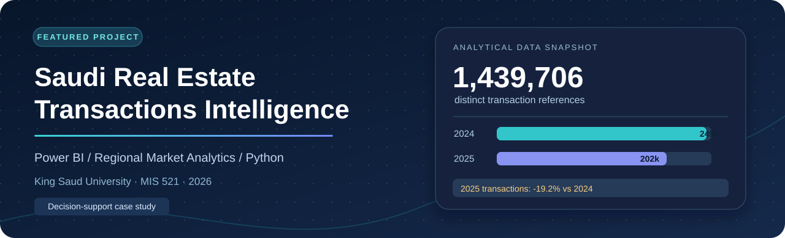
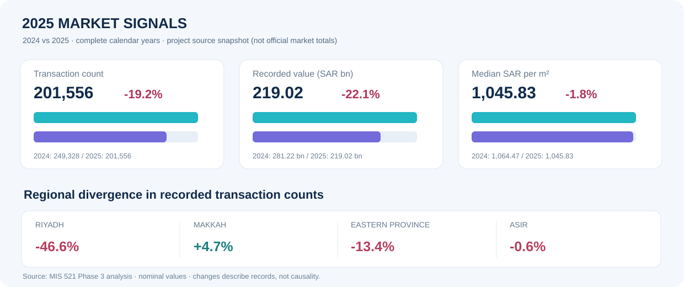

# ذكاء معاملات السوق العقاري السعودي
### تحليل الأداء السوقي ودعم القرار باستخدام Power BI وPython

**التصميم والتنفيذ: طلال إبراهيم السلطان · نظم الأعمال الذكية MIS 521 · جامعة الملك سعود · 2026**

[English README](README.md) · [النموذج وجودة البيانات](docs/data-and-model.md) · [التنبؤ](docs/forecasting.md)

## فكرة المشروع

يحوّل المشروع بيانات معاملات البيع العقاري إلى مؤشرات ولوحات تفاعلية تساعد على **متابعة النشاط، ومقارنة المناطق والمدن، ورصد التغيرات التي تستحق التحليل**. ويتكون من ثلاث مراحل مترابطة: تحديد مشكلة العمل ومؤشراتها، ثم بناء نموذج بيانات ولوحة Power BI، وأخيرًا تفسير النتائج وإضافة دراسة تنبؤية مستقلة باستخدام Python.

## أهم الأرقام المثبتة في التقرير

| المؤشر | القيمة |
|---|---:|
| المدى الزمني | 1 يناير 2020 إلى 31 مارس 2026 |
| المعاملات المميزة | **1,439,706** |
| الأرباع المشمولة | **25** |
| المناطق الإدارية الموحّدة | **13** |
| تغير عدد المعاملات 2025 مقابل 2024 | **−19.2%** |
| تغير القيمة المسجلة | **−22.1%** |
| WAPE لاختبار Random Forest التاريخي | **24.95%** |
| WAPE لخط الأساس الموسمي | **45.44%** |

## الأدوات والمنهجية

- **Power Query:** توحيد أسماء المناطق، معالجة أنواع البيانات وفحص الجودة.
- **Power BI / DAX:** نموذج نجمي للمبيعات والأبعاد، ومؤشرات كمية مع فلاتر للسنة والمنطقة والتصنيف.
- **Python / Jupyter:** اختبار تنبؤ لعدد المعاملات حسب المنطقة للربع التالي، باستخدام تقسيم زمني ومقارنة مع خط أساس موسمي.
- **الحوكمة:** قواعد مراجعة وتحديث ربع سنوي، وتصنيف المخاطر، وإثبات اختبار RLS داخل Power BI Desktop.

## ضوابط تفسير النتائج

الأرقام تخص نسخة البيانات المجمعة التي حُللت في المشروع، **ولا تمثل إحصاءات حكومية رسمية معتمدة**. الفروق السنوية لا تثبت أسبابًا اقتصادية أو تنظيمية. كذلك فإن نموذج التنبؤ بحثي: رغم تحسن WAPE المجمع مقارنة بخط الأساس، كانت قيمة R² سلبية في عشر مناطق من أصل ثلاث عشرة عند تقييم كل منطقة على حدة.

**المتاح هنا:** عرض مهني مستند إلى النتائج الموثقة، مع رسوم توضيحية وجداول وفهرس منهجي. **غير المرفوع:** ملف PBIX الأصلي والبيانات التفصيلية والدفاتر البرمجية إلى حين مراجعة حقوق مشاركة الملفات والخصوصية. وتجنّبًا للإيهام، فالرسوم المصممة هنا ليست لقطات شاشة من لوحة Power BI.

**التنفيذ الفعلي:** بحسب إفادة طلال إبراهيم السلطان، نفّذ المشروع بنفسه من حيث بناء التحليل ولوحة Power BI والنمذجة والتوثيق. **التسليم الأكاديمي:** قُدّم المشروع باسم المجموعة الثانية، وتتضمن تقارير التسليم أربعة أسماء. ويُفرّق هذا العرض بين المنفذ الفعلي وبين أسماء المجموعة المسجلة في التسليم، دون ادعاء اعتماد رسمي من الجامعة.

